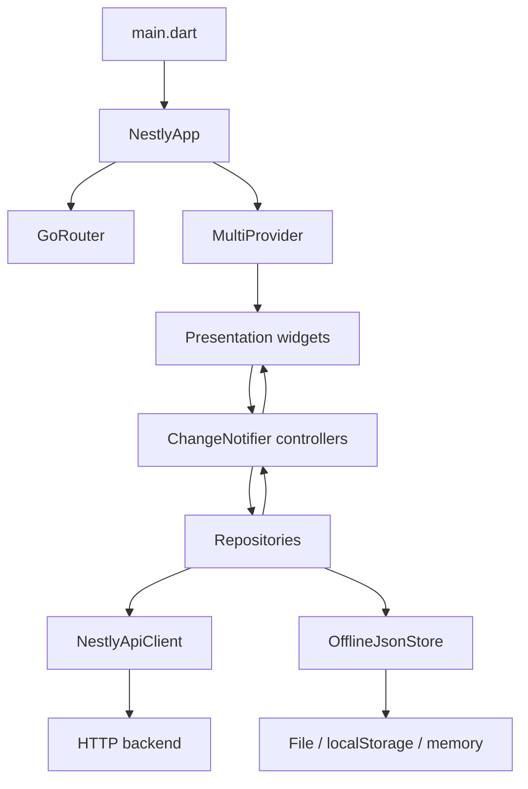
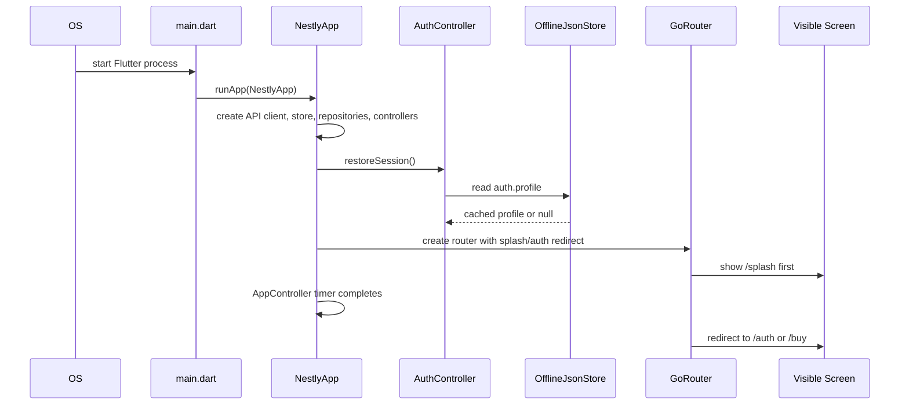
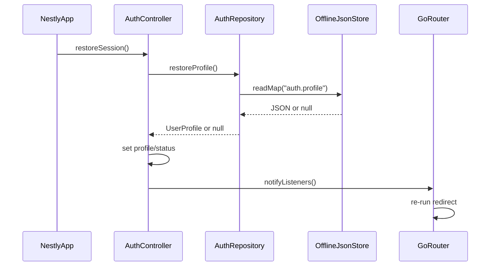
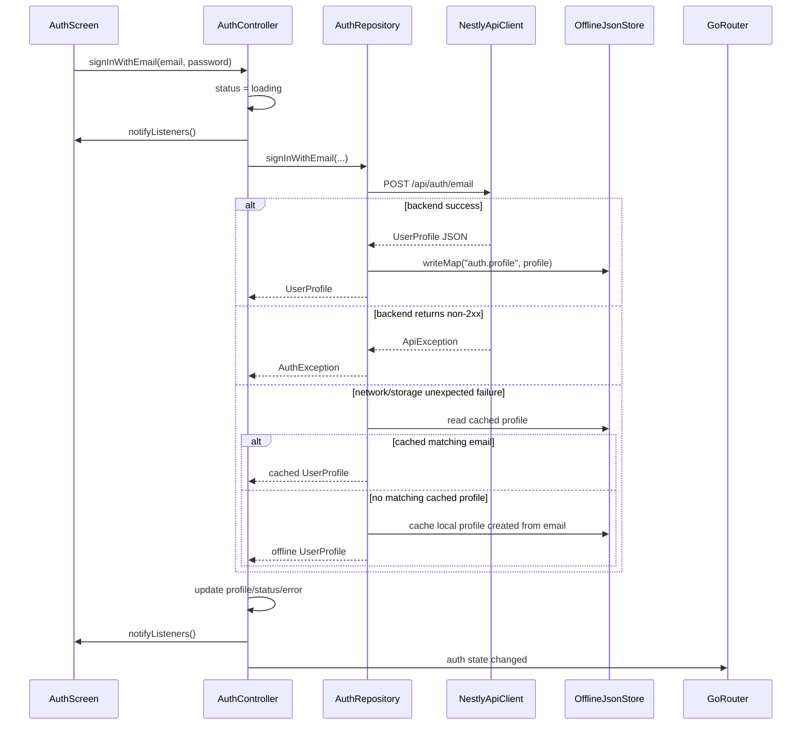
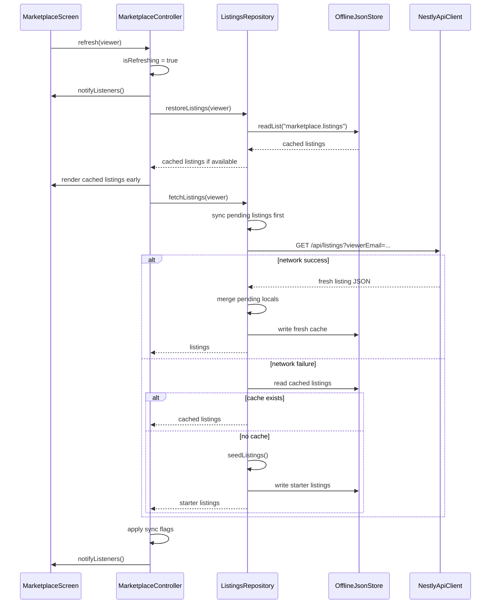
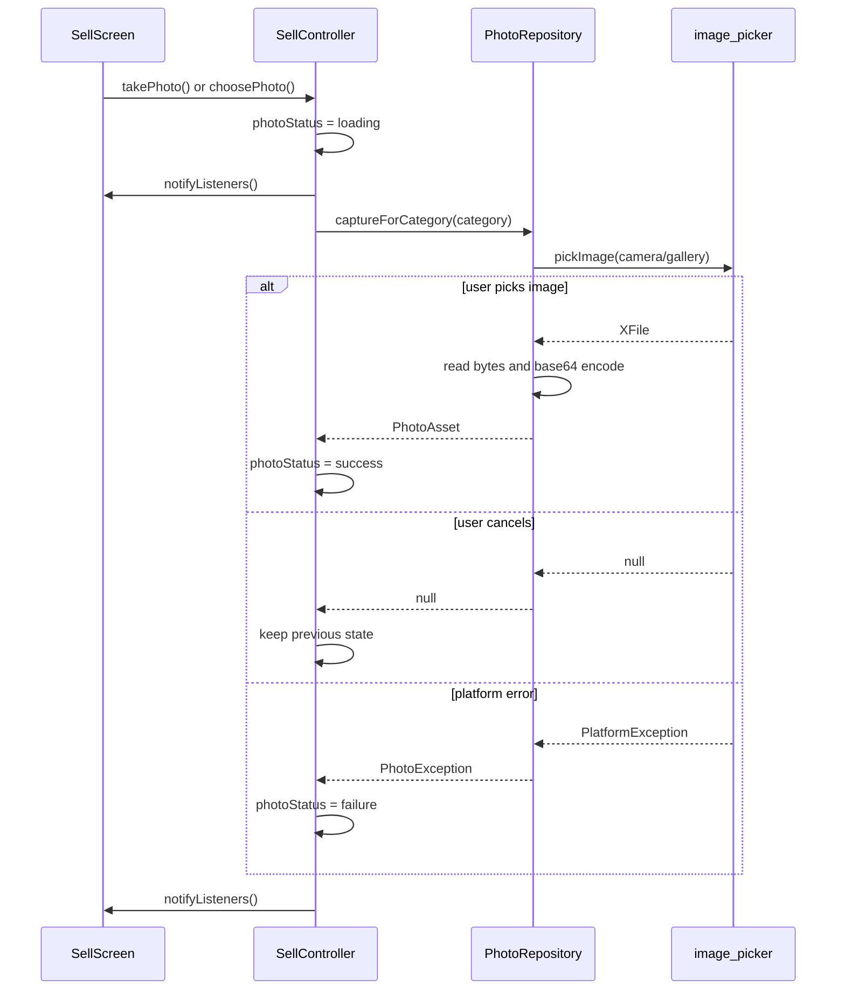
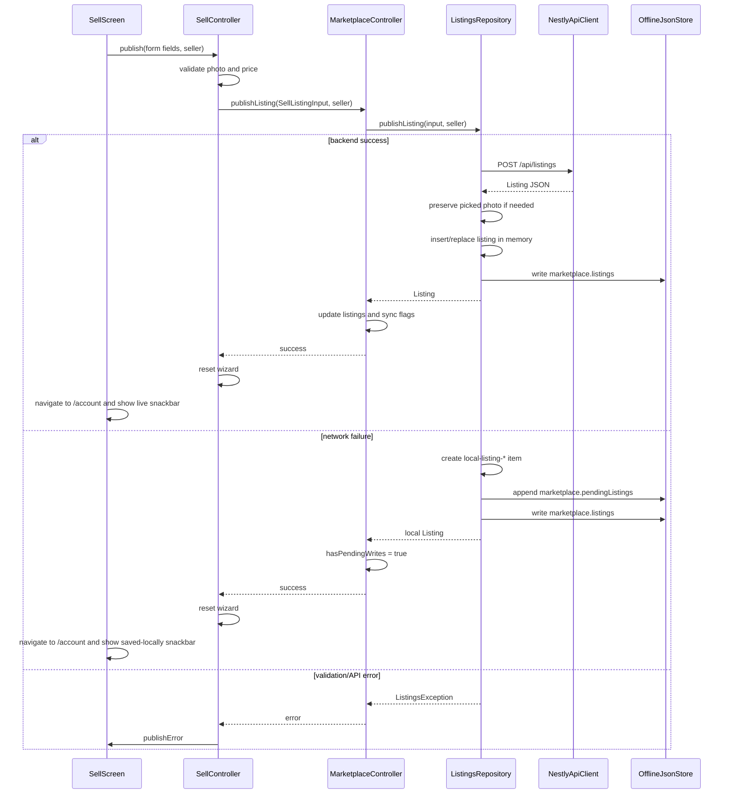
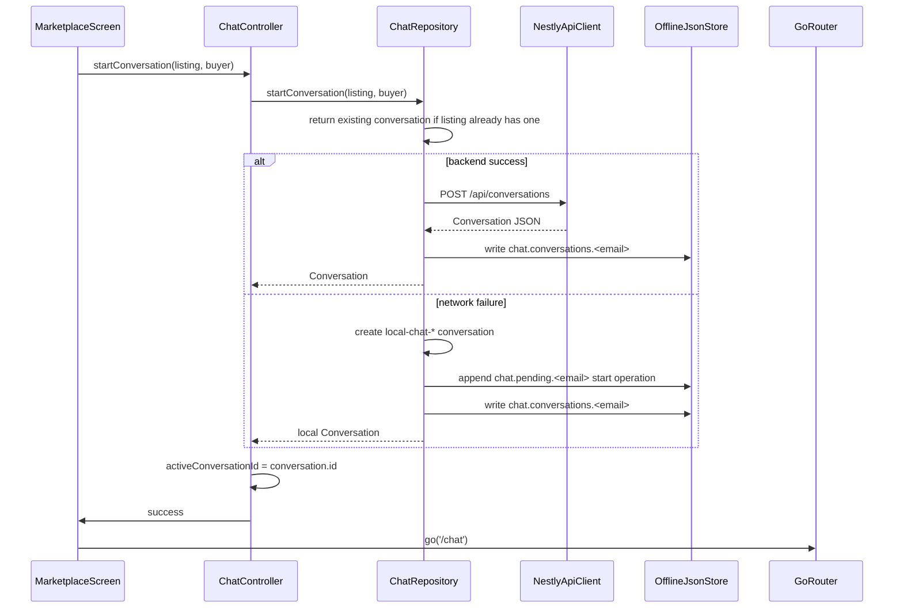
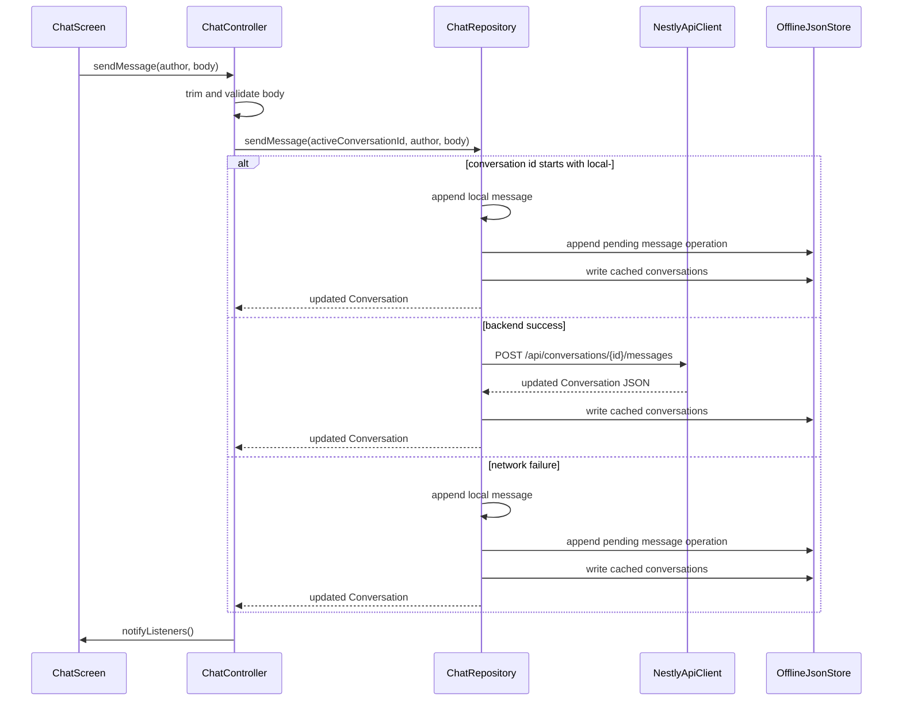

# Nestly Flutter Architecture Deep Dive

Last updated: 2026-06-05

This guide explains how the Nestly Flutter app is put together, what libraries
are used, how requests move through the system, how data flows from UI to
repositories and back, and how the offline-first behavior works.

It is written for an Android developer who already understands mobile app
concepts such as Activity, Fragment, ViewModel, Repository, Retrofit/OkHttp,
navigation graphs, local persistence, and lifecycle, but who wants to deepen
their Flutter mental model.

## 1. Executive Summary

Nestly is a marketplace app for buying, selling, and chatting about nearby
items. The app has these main flows:

- Splash and auth gate.
- Email or Google-style sign-in.
- Marketplace browsing with search, filters, sort, and item details.
- Selling flow with photo capture/gallery selection, listing details, review,
  and publish.
- Chat flow for starting conversations and sending messages.
- Account page with profile, listing metrics, chat metrics, and sign-out.
- Offline-first fallback for auth profile, marketplace listings, local publish
  operations, conversations, and messages.

The architecture is a small, feature-first Flutter architecture:

- `lib/app`: App composition, dependency creation, routing, splash state.
- `lib/core`: Shared models, networking, offline store, theme, widgets, utils.
- `lib/features/<feature>/presentation`: Screens and widgets.
- `lib/features/<feature>/state`: `ChangeNotifier` controllers.
- `lib/features/<feature>/data`: Repositories and data access.

In Android terms, the main mapping is:

| Android idea | Nestly Flutter equivalent |
| --- | --- |
| `Application` or DI component | `NestlyApp` creates shared services and controllers |
| Activity/Fragment/Compose screen | `Widget` and `Screen` classes under `presentation` |
| Navigation graph | `go_router` routes in `app_router.dart` |
| ViewModel | `ChangeNotifier` controllers under `state` |
| Repository | Repositories under `data` |
| Retrofit/OkHttp service | `NestlyApiClient` using the `http` package |
| Data class | Plain Dart model classes with manual `fromJson`/`toJson` |
| SharedPreferences/file cache | `OfflineJsonStore` backed by file/localStorage/memory |
| LiveData/StateFlow update | `notifyListeners()` plus `context.watch()` |
| Hilt/Koin injection | `provider` exposes objects through the widget tree |

This is not a heavy Clean Architecture implementation. There is no separate
domain layer, use-case layer, entity/DTO split, generated JSON code, or DI
framework. It is closer to:

```text
Screen Widget -> Controller -> Repository -> API client / Offline store
             <-            <-            <-
```

That keeps the app understandable for a small project while still separating UI
state, network/storage work, and reusable data models.

## 2. Top-Level Project Map

Important app files:

| Path | Purpose |
| --- | --- |
| `lib/main.dart` | Process entry point. Calls `runApp(const NestlyApp())`. |
| `lib/app/nestly_app.dart` | Creates services, repositories, controllers, providers, and `MaterialApp.router`. |
| `lib/app/app_router.dart` | Defines routes and auth/splash redirects using `go_router`. |
| `lib/app/app_controller.dart` | Owns splash completion state and `MergedListenable` for router refresh. |
| `lib/core/network/api_client.dart` | Thin JSON HTTP client and API response helpers. |
| `lib/core/network/api_config.dart` | Reads `NESTLY_API_BASE_URL`, defaulting to `http://localhost:8080`. |
| `lib/core/offline/*` | Cross-platform JSON persistence abstraction. |
| `lib/core/models/*` | Plain Dart model objects used across the app. |
| `lib/core/theme/*` | App colors and Material 3 theme. |
| `lib/core/widgets/*` | Shared UI pieces such as loading/error states and listing photos. |
| `lib/features/auth/*` | Auth screen, controller, repository. |
| `lib/features/marketplace/*` | Browse screen, filters/sort, controller, listings repository. |
| `lib/features/sell/*` | Sell wizard, controller, photo repository. |
| `lib/features/chat/*` | Chat screen, controller, chat repository. |
| `lib/features/account/*` | Account screen. |
| `lib/features/shell/*` | Responsive app shell with rail or bottom navigation. |
| `test/*` | Unit/widget tests and fake repositories. |
| `docs/offline_first_process.md` | Existing focused notes about offline-first behavior. |
| `docs/ci_cd_jenkins_fastlane.md` | Existing CI/CD guide. |

The app uses a feature-first folder style. That means the files for one feature
live near each other:

```text
features/
  marketplace/
    data/
      listings_repository.dart
    presentation/
      marketplace_screen.dart
    state/
      marketplace_controller.dart
      listing_sort.dart
```

This differs from a pure layer-first structure such as:

```text
data/
domain/
presentation/
```

Feature-first is usually easier to navigate when the app is small to medium
sized because all marketplace-specific code is in one neighborhood.

## 3. Libraries And Why They Are Used

The direct dependencies are declared in `pubspec.yaml`.

### Runtime Dependencies

| Library | Used for | Where it appears | Android comparison |
| --- | --- | --- | --- |
| `flutter` | Flutter SDK and core widgets. | Every screen and widget. | Android framework plus Jetpack Compose-like UI runtime. |
| `material` from Flutter | Material 3 widgets, theming, icons, layout primitives. | Screens, theme, widgets. | Material Components / Compose Material. |
| `cupertino_icons` | iOS-style icon font package. | Declared but not meaningfully used in current code. | Optional icon set. |
| `go_router` | Declarative routing, nested shell route, redirects. | `lib/app/app_router.dart`, screen navigation calls. | Navigation Component or Compose Navigation. |
| `provider` | Dependency lookup and state subscription through widget tree. | `NestlyApp`, screens using `context.watch/read`. | Lightweight Hilt + ViewModel observation, but scoped to Flutter widget tree. |
| `http` | HTTP client for JSON GET/POST calls. | `NestlyApiClient`, tests. | OkHttp plus manual JSON parsing, but lower-level than Retrofit. |
| `image_picker` | Camera and gallery image selection. | `PhotoRepository`. | Activity Result contracts for camera/gallery pickers. |

### Dev Dependencies

| Library | Used for | Where it appears | Android comparison |
| --- | --- | --- | --- |
| `flutter_test` | Unit and widget tests. | `test/*`. | JUnit plus Compose UI tests. |
| `flutter_lints` | Recommended static analysis/lint rules. | `analysis_options.yaml`. | Android lint / ktlint-style hygiene. |
| `http/testing` | `MockClient` for fake HTTP responses in tests. | `test/offline_first_repository_test.dart`. | MockWebServer-style request tests, but in-process. |

### Dart SDK Libraries Used

| Library | Used for |
| --- | --- |
| `dart:async` | `Timer`, `Future`, `unawaited`. |
| `dart:convert` | `jsonEncode`, `jsonDecode`, base64 image encoding/decoding. |
| `dart:io` | Native file-backed offline storage. |
| `dart:html` | Web localStorage-backed offline storage. |
| `dart:typed_data` | Image bytes in `PhotoAsset`. |

### Platform And Delivery Tools

These are not Flutter runtime state libraries, but they matter for the app:

| Tool | Used for |
| --- | --- |
| Gradle Kotlin DSL | Android build configuration in `android/app/build.gradle.kts`. |
| Kotlin | Android host activity in `MainActivity.kt`. |
| Flutter embedding v2 | Android `FlutterActivity` integration. |
| Jenkins | CI pipeline in `Jenkinsfile` and `ci/jenkins/*`. |
| Fastlane | Android/iOS release lanes in `fastlane/*`. |
| Bundler/Gemfile | Pins Fastlane dependency installation. |

## 4. Libraries Not Used

It is also useful to know what this app does not use:

| Not used | What the app uses instead | Consequence |
| --- | --- | --- |
| BLoC | `ChangeNotifier` controllers | Simpler for learning, less boilerplate, less explicit event/state modeling. |
| Riverpod | `provider` | Dependencies are widget-tree scoped and a little less compile-time guided. |
| GetIt | `provider` and constructor injection | No global service locator. |
| Dio | `http` | Smaller HTTP wrapper, fewer features like interceptors and cancellation. |
| Retrofit-style generated API | Manual `NestlyApiClient` calls | Easy to read, more manual endpoint typing. |
| json_serializable/freezed | Manual model classes | No code generation, more handwritten parsing and `copyWith`. |
| sqflite/Drift/Isar/Hive | JSON files/localStorage | Good for simple cache and queues, not relational querying. |
| Firebase Auth/Firestore | Custom API endpoints and offline JSON store | Backend is assumed to be custom. |
| Secure storage | Plain local JSON | Suitable for demo data, not for secrets/tokens. |

## 5. Architecture In One Diagram



Key idea:

- UI widgets render state and call controller methods.
- Controllers hold UI state and expose data to widgets.
- Repositories perform business/data work.
- API client talks to backend endpoints.
- Offline store caches data and pending operations.
- `provider` connects all of this to the widget tree.
- `go_router` controls which screen is visible.

## 6. Layer Responsibilities

### Presentation Layer

Files:

- `lib/features/auth/presentation/auth_screen.dart`
- `lib/features/marketplace/presentation/marketplace_screen.dart`
- `lib/features/sell/presentation/sell_screen.dart`
- `lib/features/chat/presentation/chat_screen.dart`
- `lib/features/account/presentation/account_screen.dart`
- `lib/features/shell/presentation/main_shell.dart`
- `lib/features/splash/presentation/splash_screen.dart`

Responsibilities:

- Build UI using Flutter widgets.
- Read state with `context.watch<Controller>()`.
- Call actions with `context.read<Controller>()`.
- Own short-lived widget-only state such as `TextEditingController`,
  selected UI toggle, password visibility, or current text field content.
- Navigate using `context.go(...)`.
- Show snackbars, modal sheets, loading states, error states, and empty states.

The presentation layer does not directly call HTTP. It does not write cache
files. It should stay mostly concerned with rendering and interaction.

### State Layer

Files:

- `AuthController`
- `MarketplaceController`
- `SellController`
- `ChatController`
- `AppController`

Responsibilities:

- Hold screen-level or app-level state.
- Represent status with `AsyncStatus`.
- Convert repository output into UI-friendly fields.
- Validate simple UI actions when appropriate.
- Call repositories.
- Call `notifyListeners()` when state changes.

Android comparison: these are closest to ViewModels. The difference is that
Flutter `ChangeNotifier` is very direct: when you mutate fields, you explicitly
call `notifyListeners()`, and widgets that used `context.watch()` rebuild.

### Data Layer

Files:

- `AuthRepository`
- `ListingsRepository`
- `PhotoRepository`
- `ChatRepository`

Responsibilities:

- Make network calls.
- Read/write offline cache.
- Queue pending offline operations.
- Decode/encode models.
- Preserve data invariants such as "a local listing starts with
  `local-listing-`" or "chat starts must sync before local messages."
- Expose repository state such as `isUsingOfflineData`, `hasPendingWrites`,
  and `syncMessage`.

### Core Layer

Files:

- `core/models/*`
- `core/network/*`
- `core/offline/*`
- `core/theme/*`
- `core/widgets/*`
- `core/data/*`
- `core/utils/*`
- `core/state/async_status.dart`

Responsibilities:

- Shared types used by several features.
- Networking primitives.
- Offline storage primitives.
- Theme and reusable UI.
- Seed/fallback data.
- Small formatting helpers.

## 7. Dependency Graph And App Startup

The app starts at `lib/main.dart`:

```dart
void main() {
  runApp(const NestlyApp());
}
```

`NestlyApp` is a `StatefulWidget` because it creates long-lived objects once in
`initState()` and disposes them in `dispose()`.

Objects created by `NestlyApp`:

| Object | Lifetime | Purpose |
| --- | --- | --- |
| `NestlyApiClient` | Whole app | Shared HTTP client. |
| `OfflineJsonStore` | Whole app | Shared cache and pending-operation store. |
| `AppController` | Whole app | Splash timer state. |
| `AuthRepository` | Whole app | Auth API/cache. |
| `ListingsRepository` | Whole app | Listings API/cache/offline queue. |
| `ChatRepository` | Whole app | Conversations API/cache/offline queue. |
| `PhotoRepository` | Whole app | Camera/gallery picking. |
| `AuthController` | Whole app | Auth state/profile. |
| `MarketplaceController` | Whole app | Marketplace state. |
| `ChatController` | Whole app | Chat state. |
| `SellController` | Per sell route | Sell wizard state. |

Notice that `SellController` is created inside the sell route, not globally:

```dart
ChangeNotifierProvider(
  create: (context) => SellController(
    context.read<PhotoRepository>(),
    context.read<MarketplaceController>(),
  ),
  child: const SellScreen(),
)
```

That means sell form state resets naturally when the sell screen provider is
created again. Marketplace and chat state stay alive across navigation because
their controllers are created at the app level.

### Startup Sequence



Important details:

- Splash is time based: `AppController.start()` waits about 1100 ms.
- Auth restore is async and starts during app initialization.
- `GoRouter` refreshes when either splash state or auth state changes.
- If splash is incomplete, every route redirects to `/splash`.
- If splash is complete but auth is missing, every route redirects to `/auth`.
- If authenticated and route is `/splash`, `/auth`, or `/`, route becomes
  `/buy`.

## 8. Provider And Flutter State Flow

`provider` is used in two ways:

1. `Provider<T>` exposes plain objects such as repositories.
2. `ChangeNotifierProvider<T>` exposes listenable controllers.

In `NestlyApp`, providers are registered above `MaterialApp.router`:

```dart
MultiProvider(
  providers: [
    Provider<AuthRepository>.value(value: _authRepository),
    ChangeNotifierProvider<AuthController>.value(value: _authController),
    ChangeNotifierProvider<MarketplaceController>.value(
      value: _marketplaceController,
    ),
  ],
  child: MaterialApp.router(...),
)
```

In screens:

```dart
final controller = context.watch<MarketplaceController>();
```

`watch` means:

- Find nearest `MarketplaceController` above this widget.
- Subscribe this widget to changes.
- Rebuild when the controller calls `notifyListeners()`.

For actions:

```dart
context.read<MarketplaceController>().refresh(...)
```

`read` means:

- Find the object.
- Do not subscribe this widget to changes.
- Good for callbacks, init hooks, and one-off commands.

This is a central Flutter idea: the UI is not manually updated. Instead, state
changes trigger rebuilds, and the current state decides what widgets are drawn.

## 9. Routing Architecture

Routes are centralized in `lib/app/app_router.dart`.

Route constants:

| Constant | Path | Screen |
| --- | --- | --- |
| `AppRoutes.splash` | `/splash` | `SplashScreen` |
| `AppRoutes.auth` | `/auth` | `AuthScreen` |
| `AppRoutes.buy` | `/buy` | `MarketplaceScreen` |
| `AppRoutes.sell` | `/sell` | `SellScreen` |
| `AppRoutes.chat` | `/chat` | `ChatScreen` |
| `AppRoutes.account` | `/account` | `AccountScreen` |

The app uses a `ShellRoute` for authenticated main screens. The shell wraps the
current child in `MainShell`, which chooses between:

- `NavigationRail` on wide layouts.
- `NavigationBar` on compact layouts.

Android comparison:

- `ShellRoute` is like a parent navigation graph that owns the common scaffold.
- The nested `GoRoute`s are like destinations inside that parent graph.
- `context.go(AppRoutes.chat)` is like navigating to a destination by route.

Redirect behavior is the route guard:

```text
if splash not complete -> /splash
else if not authenticated -> /auth
else if splash/auth/root -> /buy
else stay where you are
```

## 10. Networking

All backend calls go through `NestlyApiClient`.

### API Configuration

`ApiConfig.baseUrl` is read from a compile-time environment value:

```dart
static const baseUrl = String.fromEnvironment(
  'NESTLY_API_BASE_URL',
  defaultValue: 'http://localhost:8080',
);
```

Run/build example:

```bash
flutter run --dart-define=NESTLY_API_BASE_URL=http://10.0.2.2:8080
```

For Android emulator, `10.0.2.2` is often needed to reach a backend running on
the host machine. The code default is `localhost`, which works in some desktop
or web contexts but usually not for Android emulator backend access.

### API Client Behavior

`NestlyApiClient` exposes:

```dart
Future<Object?> getJson(String path, {Map<String, String?> queryParameters})
Future<Object?> postJson(String path, Map<String, Object?> body)
```

It:

- Resolves the path against the base URI.
- Removes null or blank query parameters.
- Encodes POST bodies with `jsonEncode`.
- Adds `Content-Type: application/json` for POST.
- Decodes JSON responses.
- Treats status codes from 200 to 299 as success.
- Throws `ApiException` for non-2xx responses.
- Extracts server error messages from JSON field `message` when present.

### Backend Endpoints Implied By The App

| Method | Path | Used by | Expected data |
| --- | --- | --- | --- |
| `POST` | `/api/auth/email` | Email sign-in | Body: `email`, `password`. Response: `UserProfile`. |
| `POST` | `/api/auth/google` | Google-style sign-in | Body: `name`, `email`. Response: `UserProfile`. |
| `GET` | `/api/listings` | Marketplace refresh | Query: optional `viewerEmail`. Response: list of `Listing`. |
| `POST` | `/api/listings` | Publish listing | Body: listing fields and `photo`. Response: `Listing`. |
| `GET` | `/api/conversations` | Chat refresh | Query: `buyerEmail`. Response: list of `Conversation`. |
| `POST` | `/api/conversations` | Start chat | Body: `listingId`, `buyerEmail`, `buyerName`. Response: `Conversation`. |
| `POST` | `/api/conversations/{id}/messages` | Send message | Body: `authorEmail`, `authorName`, `body`. Response: `Conversation`. |

Current auth note:

- There is no token handling in the current app.
- The backend API shape assumes identity is passed in request bodies or query
  parameters.
- For production, you would normally add real auth tokens, secure storage, and
  authenticated request headers.

## 11. Offline Storage

Offline storage is built around a tiny abstraction:

```dart
abstract class OfflineStoreBackend {
  Future<String?> read(String key);
  Future<void> write(String key, String value);
  Future<void> remove(String key);
}
```

`OfflineJsonStore` sits above that and offers JSON-shaped methods:

```dart
readMap(key)
readList(key)
writeMap(key, value)
writeList(key, value)
remove(key)
```

Platform-specific backend selection uses conditional imports:

```dart
import 'offline_store_backend_factory.dart'
    if (dart.library.io) 'offline_store_backend_io.dart'
    if (dart.library.html) 'offline_store_backend_web.dart';
```

Backends:

| Backend | Platform | Storage |
| --- | --- | --- |
| `FileOfflineStoreBackend` | Mobile/desktop/native Dart IO | JSON files under `~/.nestly`, fallback to temp directory. |
| `BrowserOfflineStoreBackend` | Web | Browser `localStorage` with `nestly:` prefix. |
| `MemoryOfflineStoreBackend` | Tests/fallback | In-memory map. |

Offline keys currently used:

| Key | Used by | Meaning |
| --- | --- | --- |
| `auth.profile` | `AuthRepository` | Cached signed-in profile. |
| `marketplace.listings` | `ListingsRepository` | Cached listing list. |
| `marketplace.pendingListings` | `ListingsRepository` | Offline publish queue. |
| `chat.conversations.<email>` | `ChatRepository` | Cached conversations per buyer email. |
| `chat.pending.<email>` | `ChatRepository` | Offline chat operation queue per buyer email. |

`offlineKeyPart()` normalizes emails and other user-provided key parts:

- Trims whitespace.
- Lowercases.
- Replaces unsafe characters with `_`.
- Uses `anonymous` for blank values.

Important implementation choice:

- Offline storage errors are swallowed in many places.
- That means local storage is an enhancement. If writing cache fails, the app
  tries to keep running instead of crashing.

## 12. Data Models

The app uses plain Dart classes with manual JSON serialization.

### `UserProfile`

Fields:

- `name`
- `email`

Used by:

- Auth state.
- Listing ownership checks.
- Chat buyer/author information.
- Account display.

### `PhotoAsset`

Fields:

- `iconKey`
- `colorValue`
- optional `imageData` as base64.

Behavior:

- `imageBytes` decodes base64 for `Image.memory`.
- If decoding fails, UI falls back to an icon.

This lets the app store picked images inside JSON cache. That is simple, but it
can make cache files large. A production app might store image files separately
and cache only local file paths or remote URLs.

### `Listing`

Fields:

- `id`
- `title`
- `category`
- `price`
- `condition`
- `location`
- `description`
- `sellerName`
- `sellerEmail`
- `createdAt`
- `photo`
- `likes`
- `isMine`

Behavior:

- `copyWith()` supports small immutable updates.
- `fromJson()` tolerates some numeric values as strings.
- `toJson()` serializes dates as UTC ISO strings.

`isMine` is UI-facing ownership state. The repository can recompute it by
comparing `sellerEmail` with the current viewer email.

### `Conversation`

Fields:

- `id`
- `listing`
- `messages`

Behavior:

- Stores messages as `List.unmodifiable`.
- `copyWith(messages: ...)` creates a conversation with changed messages.
- Serializes nested listing and message JSON.

### `ChatMessage`

Fields:

- `authorName`
- `body`
- `sentAt`
- `fromCurrentUser`

`fromCurrentUser` is presentation-oriented. It decides whether the message
bubble is aligned left or right.

## 13. Async State Model

The app uses one enum:

```dart
enum AsyncStatus { idle, loading, success, failure }
```

Controllers combine this with fields such as:

- `errorMessage`
- `syncMessage`
- `isRefreshing`
- `isUsingOfflineData`
- `hasPendingWrites`

Example from marketplace:

```text
status = loading
restore cached listings
status = success if cache appears
fetch remote listings
status = success or failure
apply repository sync state
notify listeners
```

This gives the UI enough information to render:

- Loading indicators.
- Empty states.
- Error states.
- Offline/sync info banners.
- Disabled buttons during operations.

## 14. Auth Flow

Files:

- `AuthScreen`
- `AuthController`
- `AuthRepository`
- `UserProfile`
- `OfflineJsonStore`

### Session Restore Flow



If a cached profile exists, the user becomes authenticated without entering
credentials again.

### Email Sign-In Flow



Important behavior:

- Non-2xx API responses become user-facing auth failures.
- Network-style failures can fall back to a cached profile.
- If no profile exists for email sign-in, the app creates a local offline
  profile from the email.
- This is convenient for demos and offline testing.
- It is not production-grade authentication.

### Google Sign-In Flow

Current Google sign-in is simulated:

- It sends static `Google User` and `google.user@nestly.app` to
  `/api/auth/google`.
- If the network fails, it uses a cached profile.
- If no cached profile exists, it creates a local Google User profile.

There is no actual Google SDK/OAuth flow in this codebase yet.

### Sign-Out Flow

```text
AuthScreen/AccountScreen action
-> AuthController.signOut()
-> clear profile and status
-> unawaited(AuthRepository.forgetProfile())
-> OfflineJsonStore.remove("auth.profile")
-> notifyListeners()
-> GoRouter redirects to /auth
```

`unawaited` means the UI does not block on cache deletion.

## 15. Marketplace Browse Flow

Files:

- `MarketplaceScreen`
- `MarketplaceController`
- `ListingsRepository`
- `NestlyApiClient`
- `OfflineJsonStore`
- `Listing`
- `seed_listings.dart`

### Screen Initialization

`MarketplaceScreen` is stateful because it owns a `TextEditingController`.

In `initState()`:

- The search text controller is connected to
  `MarketplaceController.updateQuery`.
- After the first frame, if no listings exist, it calls
  `controller.refresh(viewer: auth.profile)`.

Why after the first frame?

- You can safely read providers after the widget is mounted.
- It avoids starting async work during `build()`.

### Refresh Flow



Important details:

- The controller first restores cached data, then fetches fresh data.
- This gives a quick UI even when the network is slow.
- If network fails, repository falls back to cache.
- If cache is empty, repository falls back to bundled seed listings.
- Pending offline publishes are synced before fresh listings are fetched.

### Filtering And Sorting

Filtering happens in `MarketplaceController.filteredListings`.

Inputs:

- `_query`
- `_category`
- `_condition`
- `_sort`
- `_listings`

The controller excludes `isMine` items from browse results:

```dart
List<Listing> get browseListings =>
    _listings.where((listing) => !listing.isMine).toList(growable: false);
```

That means your own published items are shown in Account, not in the buy grid.

Sort options:

| Sort | Behavior |
| --- | --- |
| `newest` | Descending `createdAt`. |
| `priceLow` | Ascending `price`. |
| `priceHigh` | Descending `price`. |
| `popular` | Descending `likes`. |

### Offline Simulation

The marketplace screen has a cloud-off button:

```dart
controller.refresh(viewer: profile, fail: true)
```

`fail: true` forces repository fallback by throwing an internal offline sync
exception. This is a test/demo control to show offline UI behavior.

## 16. Publish Listing Flow

Files:

- `SellScreen`
- `SellController`
- `PhotoRepository`
- `MarketplaceController`
- `ListingsRepository`
- `PhotoAsset`
- `Listing`

The sell flow is a three-step wizard:

1. Photo.
2. Details.
3. Review.

### Photo Capture/Gallery Flow



Android platform setup:

- `android/app/src/main/AndroidManifest.xml` declares camera/media permissions.
- `MainActivity.kt` extends `FlutterActivity`.
- The plugin handles platform communication through Flutter plugin channels.

iOS platform setup:

- `ios/Runner/Info.plist` includes camera and photo library usage descriptions.

### Publish Flow



Important details:

- Prices above 50000 are rejected in the repository.
- Offline publish is considered a success from the user's perspective because
  the listing is saved locally and queued.
- Offline local listing IDs start with `local-listing-`.
- Pending publish operations are stored under `marketplace.pendingListings`.
- The next successful marketplace refresh attempts to sync them.

### Pending Listing Sync

When `ListingsRepository.fetchListings()` runs:

1. It calls `_syncPendingListings()`.
2. It reads `marketplace.pendingListings`.
3. It POSTs each queued request to `/api/listings`.
4. On success, it replaces the local listing ID with the server listing.
5. On failure, it keeps that pending item in the queue.
6. It writes the remaining queue back to offline storage.
7. It fetches fresh listings from the backend.
8. It merges any still-pending local listings ahead of fresh results.

This creates a simple retry-on-refresh model.

## 17. Chat Flow

Files:

- `MarketplaceScreen`
- `ChatScreen`
- `ChatController`
- `ChatRepository`
- `Conversation`
- `ChatMessage`
- `Listing`
- `OfflineJsonStore`

### Start Chat From Marketplace

When the user taps the chat icon on a listing:

```text
ListingCard
-> MarketplaceScreen._startChat(listing)
-> read AuthController.profile
-> ChatController.startConversation(listing, buyer)
-> ChatRepository.startConversation(...)
-> on success context.go('/chat')
```

### Start Conversation Request Flow



Important details:

- Starting an existing conversation returns the existing one instead of
  creating duplicates.
- Offline local conversation IDs start with `local-chat-`.
- Pending chat starts are stored as operations with type `start`.

### Chat Screen Refresh Flow

`ChatScreen` refreshes after first frame if:

- A profile exists.
- There are no conversations yet.

Refresh behavior:

```text
ChatController.refresh(buyer)
-> repository.restoreConversations(buyer)
-> render cached chats early if present
-> repository.fetchConversations(buyer)
-> sync pending chat operations
-> GET /api/conversations?buyerEmail=...
-> cache and render fresh conversations
-> fallback to cached conversations on failure
```

### Send Message Flow



Important details:

- Empty messages are rejected in the controller before repository calls.
- If the active conversation is local, messages are always saved locally first.
- If sending to a server conversation fails unexpectedly, the message is saved
  locally and queued.
- API exceptions are treated as user-facing chat errors.

### Pending Chat Sync

Chat sync is more complex than listing sync because a message may depend on a
conversation that does not exist on the server yet.

The queue can contain:

| Operation type | Meaning |
| --- | --- |
| `start` | Create conversation on the server. |
| `message` | Send a message to a conversation. |

Sync order:

1. Read pending operations for the buyer.
2. Process operations in order.
3. If operation is `start`, POST `/api/conversations`.
4. Map local conversation ID to server conversation ID.
5. Merge any local messages into the server conversation.
6. If operation is `message`, remap local conversation ID to server ID when
   possible.
7. POST `/api/conversations/{id}/messages`.
8. If any operation fails, keep that operation and all following operations.
9. Write the remaining queue back to offline storage.
10. Write updated cached conversations.

Why the ID map matters:

```text
offline:
  start local-chat-sara-listing-desk-123
  message conversationId=local-chat-sara-listing-desk-123

online sync:
  POST start -> server-chat
  map local-chat-sara-listing-desk-123 -> server-chat
  POST message to /api/conversations/server-chat/messages
```

Without this remapping, a queued message would still point at a local-only ID
that the server does not understand.

## 18. Account Flow

Files:

- `AccountScreen`
- `AuthController`
- `MarketplaceController`
- `ChatController`

The account screen is a read-only aggregator plus sign-out action:

- Reads current profile from `AuthController`.
- Reads active listing count from `MarketplaceController.activeListings`.
- Reads chat count from `ChatController.conversations.length`.
- Shows `marketplace.ownListings`.
- Calls `auth.signOut` from the sign-out button.

There is no account repository. The screen composes already-loaded state from
other controllers.

## 19. UI Rendering And Shared Widgets

The UI uses Material 3 and small shared widgets.

### Theme

`buildNestlyTheme()` configures:

- Material 3.
- Color scheme from app colors.
- Light scaffold background.
- Input decoration style.
- Filled/elevated/outlined button styles.
- Chip style.
- App bar defaults.

### Shared Widgets

| Widget | Purpose |
| --- | --- |
| `BrandMark` | Circular Nestly home mark. |
| `ResponsiveContent` | Centers content with max width. |
| `panelDecoration()` | Common white panel styling. |
| `LoadingState` | Standard loading panel. |
| `EmptyState` | Standard empty panel. |
| `ErrorState` | Standard error panel with optional retry. |
| `ErrorBanner` | Inline error message. |
| `InfoBanner` | Inline info/sync/offline message. |
| `StatusPill` | Compact icon+label metadata pill. |
| `ListingPhoto` | Listing-specific photo wrapper. |
| `PhotoAssetView` | Displays picked image bytes or fallback icon. |

### Responsive Behavior

Examples:

- `MainShell` uses `NavigationRail` at width >= 900 and `NavigationBar`
  otherwise.
- `MarketplaceGrid` uses 3 columns at >= 980, 2 columns at >= 640, and 1
  column below that.
- `MarketplaceFilters` switch from row layout to column layout below 680.
- `ChatScreen` uses side-by-side conversation list/detail at >= 780 and stacked
  layout below that.
- `SellScreen` details form uses two columns at >= 720.

Flutter layout concept:

- Parent widgets pass constraints down.
- Child widgets choose a size within those constraints.
- Parent widgets position children.

`LayoutBuilder` is used when the widget needs to choose layout based on the
actual space it receives.

## 20. Data Flow Patterns By Feature

### Read-Heavy Flow

Marketplace and chat refreshes use this pattern:

```text
UI appears
-> controller.refresh()
-> status/loading flags update
-> repository.restore from offline cache
-> UI may show cached state immediately
-> repository.fetch remote data
-> repository writes cache
-> controller updates fields
-> UI rebuilds
```

This pattern creates fast startup and offline resilience.

### Write-Heavy Flow

Publishing listings and sending messages use this pattern:

```text
UI action
-> controller validates and sets loading
-> repository tries remote write
-> if success: update memory and cache
-> if offline: update memory, cache, and pending queue
-> controller copies repository flags
-> UI shows live or pending-sync state
```

The key idea is optimistic local continuity. The user can keep working even
when the backend is unavailable.

### Repository Sync Flags

Repositories expose:

```dart
bool get isUsingOfflineData
bool get hasPendingWrites
String? get syncMessage
```

Controllers copy these into UI-facing fields:

```dart
void _applyRepositoryState() {
  _isUsingOfflineData = _repository.isUsingOfflineData;
  _hasPendingWrites = _repository.hasPendingWrites;
  _syncMessage = _repository.syncMessage;
}
```

Screens display `syncMessage` in `InfoBanner`.

## 21. Error Handling Strategy

The app distinguishes a few kinds of errors:

### API Exceptions

`NestlyApiClient` throws `ApiException` for non-2xx backend responses.

Repositories often translate these to feature-specific exceptions:

- `AuthException`
- `ListingsException`
- `ChatException`
- `PhotoException`

This prevents screens from knowing about low-level API details.

### Network Or Unexpected Errors

Repositories often catch broad failures to support offline behavior.

Examples:

- `ListingsRepository.fetchListings()` falls back to cache or seeds.
- `ListingsRepository.publishListing()` creates a local listing and queue item.
- `ChatRepository.sendMessage()` saves a local message and queue item.
- `AuthRepository.signInWithEmail()` uses cached or local profile fallback.

### UI Validation Errors

Some validation stays in screens/controllers:

- Auth form validates email and password length.
- Sell form validates title, price, location, description.
- Chat controller rejects empty messages.
- Sell controller rejects missing photo/invalid price before publish.

## 22. Testing Strategy

Current tests cover both logic and UI:

| Test file | Covers |
| --- | --- |
| `test/offline_first_repository_test.dart` | Offline listing cache fallback, ownership marking, offline publish queue sync, offline chat start/message queue sync. |
| `test/controller_test.dart` | Marketplace controller filtering/publish behavior, chat controller start/send behavior. |
| `test/widget_test.dart` | App auth validation and navigation to marketplace after sign-in. |
| `test/chat_screen_test.dart` | Chat bubble spacing/layout. |
| `test/listing_photo_widget_test.dart` | Listing photo widget behavior. |
| `test/fakes.dart` | Fake repositories for widget/controller tests. |

Testing tools:

- `flutter_test` for unit and widget tests.
- `MockClient` from `http/testing` for backend simulation.
- `OfflineJsonStore.inMemory()` for deterministic offline store tests.
- Fake repositories for widget tests where real HTTP/storage is not needed.

Android comparison:

- Widget tests are closer to Compose UI tests than Espresso tests.
- `tester.pumpWidget()` mounts a widget tree.
- `tester.tap`, `tester.enterText`, and `find.text` interact with and inspect
  the rendered Flutter tree.
- `pump` and `pumpAndSettle` advance frames and async UI updates.

## 23. CI/CD And Native Build Notes

This repo includes CI/CD scaffolding:

- `Jenkinsfile`
- `ci/jenkins/docker-compose.yml`
- `ci/jenkins/Dockerfile`
- `ci/jenkins/plugins.txt`
- `fastlane/Fastfile`
- `fastlane/Appfile`
- `Gemfile`
- `android/key.properties.example`

Android build config:

- Namespace/application ID is currently `com.example.nestly`.
- Java target/source compatibility is 17.
- Kotlin JVM target is 17.
- Release signing can read from `android/key.properties` or environment
  variables:
  - `ANDROID_KEYSTORE_PATH`
  - `ANDROID_KEYSTORE_PASSWORD`
  - `ANDROID_KEY_ALIAS`
  - `ANDROID_KEY_PASSWORD`
- If release signing values are missing, release build falls back to debug
  signing.

Before store release:

- Change `com.example.nestly` to a real app/package ID.
- Configure Google Play and Apple Bundle IDs consistently.
- Replace demo auth behavior with real authentication.
- Confirm backend base URL strategy for each environment.

## 24. How To Read This Codebase Efficiently

Recommended reading order:

1. `lib/main.dart`
2. `lib/app/nestly_app.dart`
3. `lib/app/app_router.dart`
4. `lib/features/auth/state/auth_controller.dart`
5. `lib/features/auth/data/auth_repository.dart`
6. `lib/features/marketplace/state/marketplace_controller.dart`
7. `lib/features/marketplace/data/listings_repository.dart`
8. `lib/features/sell/state/sell_controller.dart`
9. `lib/features/chat/state/chat_controller.dart`
10. `lib/features/chat/data/chat_repository.dart`
11. `lib/core/offline/offline_json_store.dart`
12. `lib/core/network/api_client.dart`
13. Screen files under `presentation`.
14. Tests under `test`.

When reading any feature, follow this path:

```text
Screen action
-> Controller method
-> Repository method
-> API/offline store
-> Repository result
-> Controller fields
-> Widget rebuild
```

That is the main rhythm of this app.

## 25. How To Add A New Backend Request

Example: adding "like listing".

Recommended steps:

1. Add or confirm backend endpoint shape, for example
   `POST /api/listings/{id}/like`.
2. Add a method in `ListingsRepository`, not directly in the screen.
3. Use `_apiClient.postJson(...)` inside the repository.
4. Update in-memory `_listings`.
5. Write updated listings to offline cache.
6. Decide offline behavior:
   - fail with an error, or
   - update locally and queue a pending like operation.
7. Add controller method in `MarketplaceController`.
8. Call that controller method from the UI.
9. Add tests:
   - repository success.
   - repository offline behavior.
   - controller state update.
   - widget behavior if the UI changes.

Keep the dependency direction the same:

```text
UI -> Controller -> Repository -> API/store
```

Do not make the UI call `NestlyApiClient` directly.

## 26. How To Add A New Feature

Suppose you add a Favorites feature.

Suggested folders:

```text
lib/features/favorites/
  data/
    favorites_repository.dart
  presentation/
    favorites_screen.dart
  state/
    favorites_controller.dart
```

Suggested integration:

1. Create models in `core/models` only if shared by multiple features.
2. Keep feature-only models inside the feature if they are not reused.
3. Create repository with constructor-injected `NestlyApiClient` and
   `OfflineJsonStore` if needed.
4. Create controller extending `ChangeNotifier`.
5. Register repository/controller in `NestlyApp`.
6. Add route constant and `GoRoute` in `app_router.dart`.
7. Add navigation destination in `MainShell` if it is top-level.
8. Add tests using fake repositories or `MockClient`.

## 27. Important Flutter Concepts Shown In This App

### Widgets Are Descriptions

Flutter widgets are immutable descriptions of UI. When state changes, Flutter
does not mutate a button in place the way old Android Views might feel. It
re-runs `build()` and reconciles the widget tree.

### State Lives Outside Build

State that must survive rebuilds lives in:

- `State<T>` objects for local widget concerns.
- `ChangeNotifier` controllers for screen/app concerns.
- Repositories/offline store for data concerns.

### Build Should Be Fast And Side-Effect Light

This app generally starts async work in:

- `initState()`
- post-frame callbacks
- button handlers
- controller methods

It avoids making network calls directly inside `build()`.

### Context Is A Tree Lookup

`context.watch<T>()` and `context.read<T>()` search upward in the widget tree.
That is why providers must be above the screens that use them.

### Dispose Matters

Objects that hold resources are disposed:

- Text controllers in screens.
- Controllers in `NestlyApp`.
- Router and merged listenable.
- HTTP client when `NestlyApp` owns it.

This is similar to cleaning subscriptions/resources in Android lifecycle-aware
classes, but the exact lifecycle is the widget tree lifecycle.

## 28. Current Architecture Strengths

Good things this codebase already does:

- Clear feature-first organization.
- UI does not directly call HTTP.
- Repositories are constructor-injectable, making tests simple.
- Offline storage is abstracted behind a small interface.
- Tests use `MockClient` and in-memory store for realistic repository behavior.
- Router guards are centralized.
- Shared widgets keep loading/error/empty states consistent.
- Controllers expose simple state to screens.
- The app handles offline publishing and messaging instead of just failing.
- Responsive layouts are handled in the actual screens.

## 29. Current Tradeoffs And Production Gaps

These are not necessarily bugs. They are important learning points.

| Area | Current behavior | Production consideration |
| --- | --- | --- |
| Auth | Local fallback profile, no real token. | Add real OAuth/email auth, token refresh, secure storage. |
| API client | Minimal `http` wrapper. | Add auth headers, timeouts, retries, logging, typed responses. |
| Offline store | JSON files/localStorage. | Consider database for larger data, indexing, migrations. |
| Image storage | Base64 images inside JSON. | Store files separately or upload images to backend/cloud storage. |
| Sync | Retry on refresh only. | Add background sync, conflict resolution, exponential backoff. |
| Errors | Broad catches for offline fallback. | Log errors and distinguish storage, network, parsing, and server failures. |
| Models | Manual JSON parsing. | Consider `json_serializable` or `freezed` if model count grows. |
| State management | `ChangeNotifier` and provider. | Fine for this size; consider Riverpod/BLoC only if complexity demands it. |
| Security | Plain cache. | Do not store secrets in this store. Use secure storage for credentials/tokens. |
| Pagination | Fetches full listing/conversation lists. | Add paging/infinite scroll for real marketplace scale. |
| Backend URL | Compile-time dart define. | Add environment/flavor strategy for dev/staging/prod. |

## 30. Glossary For Android Developers

| Flutter term | Meaning in this app |
| --- | --- |
| `Widget` | Immutable UI description. Similar mental role to a composable function. |
| `StatefulWidget` | Widget with a paired mutable `State` object. |
| `StatelessWidget` | Widget whose output depends only on constructor args and inherited state. |
| `BuildContext` | Handle to a position in the widget tree. Used for theme, navigation, providers. |
| `ChangeNotifier` | Simple observable state holder. |
| `notifyListeners()` | Tells subscribers to rebuild/read state again. |
| `Provider` | Makes an object available below a point in the widget tree. |
| `context.watch<T>()` | Read and subscribe to changes. |
| `context.read<T>()` | Read once without subscribing. |
| `MaterialApp.router` | Root Material app configured by a router. |
| `GoRouter` | Declarative route table and navigation manager. |
| `ShellRoute` | Route wrapper for shared scaffold/navigation. |
| `Future` | Async result, like a coroutine `Deferred`/suspend result conceptually. |
| `async`/`await` | Dart async syntax. Similar to Kotlin coroutine style at call sites. |
| `const` widget | Compile-time immutable widget instance when possible. Helps performance/readability. |

## 31. One Complete Example: Offline Publish End-To-End

This flow touches most architectural parts:

```text
1. User opens /sell.
2. app_router.dart creates SellController for the sell route.
3. SellScreen reads SellController with context.watch.
4. User chooses a photo.
5. SellController calls PhotoRepository.
6. PhotoRepository calls image_picker.
7. Picked bytes become PhotoAsset.imageData base64.
8. User enters details and taps Publish listing.
9. SellController validates photo/price.
10. SellController calls MarketplaceController.publishListing.
11. MarketplaceController calls ListingsRepository.publishListing.
12. ListingsRepository tries POST /api/listings.
13. Network fails.
14. ListingsRepository creates Listing with id local-listing-*.
15. ListingsRepository inserts local listing into memory.
16. ListingsRepository writes pending request to marketplace.pendingListings.
17. ListingsRepository writes updated marketplace.listings cache.
18. ListingsRepository marks isUsingOfflineData and hasPendingWrites.
19. MarketplaceController copies repository state.
20. SellController resets wizard and returns success.
21. SellScreen navigates to /account.
22. Snackbar says the listing was saved locally.
23. AccountScreen shows the listing because MarketplaceController.ownListings
    includes isMine listings.
24. Later, user refreshes marketplace online.
25. ListingsRepository syncs pending listing first.
26. Server returns a real listing ID.
27. Repository replaces local-listing-* with server listing.
28. Pending queue becomes empty.
29. Cache is rewritten.
30. Info banner disappears.
```

That is the app's architecture in action: UI stays responsive, controller
state is simple, repository owns data complexity, and offline storage preserves
the user's work.

## 32. One Complete Example: Offline Chat End-To-End

```text
1. User taps chat on a marketplace listing.
2. MarketplaceScreen reads AuthController.profile.
3. MarketplaceScreen calls ChatController.startConversation.
4. ChatController calls ChatRepository.startConversation.
5. Network fails.
6. ChatRepository creates local-chat-* conversation.
7. ChatRepository queues a start operation in chat.pending.<email>.
8. ChatRepository caches conversation in chat.conversations.<email>.
9. ChatController selects the local conversation.
10. MarketplaceScreen navigates to /chat.
11. User writes a message.
12. ChatController validates non-empty text.
13. ChatController calls ChatRepository.sendMessage.
14. Repository sees conversation ID starts with local-.
15. Repository appends local message.
16. Repository queues a message operation.
17. Repository rewrites cached conversations.
18. UI shows the message immediately with pending sync banner.
19. Later, ChatController.refresh runs online.
20. Repository processes pending start operation.
21. Server returns server conversation ID.
22. Repository maps local ID to server ID.
23. Repository remaps pending message to server ID.
24. Repository POSTs message to server conversation.
25. Repository fetches fresh conversations.
26. Repository clears pending queue.
27. UI shows synced chat without pending banner.
```

This is the best example in the app of why local IDs and operation ordering
matter.

## 33. Quick Reference: Where To Change What

| Goal | Start here |
| --- | --- |
| Change route behavior | `lib/app/app_router.dart` |
| Add top-level tab | `lib/features/shell/presentation/main_shell.dart` and router |
| Change app colors/theme | `lib/core/theme/app_colors.dart`, `app_theme.dart` |
| Change marketplace filters | `MarketplaceController.filteredListings`, `MarketplaceFilters` |
| Change backend base URL | `lib/core/network/api_config.dart` or `--dart-define` |
| Add request headers | `lib/core/network/api_client.dart` |
| Change auth behavior | `AuthRepository`, `AuthController`, `AuthScreen` |
| Change offline listing sync | `ListingsRepository` |
| Change offline chat sync | `ChatRepository` |
| Change photo behavior | `PhotoRepository`, Android manifest, iOS Info.plist |
| Change account metrics | `AccountScreen` |
| Add shared UI state component | `lib/core/widgets/states.dart` or a new core widget |
| Add tests for repository behavior | `test/offline_first_repository_test.dart` |
| Add tests for controller behavior | `test/controller_test.dart` |
| Add widget tests | `test/widget_test.dart` or feature-specific widget test |

## 34. Suggested Next Learning Steps

To deepen Flutter from this codebase:

1. Trace one button press from widget to repository and back.
2. Add a small repository method with a `MockClient` test.
3. Add one field to `Listing` and update `fromJson`, `toJson`, UI, and tests.
4. Replace one screen-local `setState` flag with controller state and compare.
5. Add a new route and navigation destination.
6. Add a new offline pending operation and write a sync test for it.
7. Run widget tests and inspect how `pumpWidget`, `pump`, and `pumpAndSettle`
   map to frames.
8. Experiment with `context.read` vs `context.watch` to see rebuild behavior.
9. Try a fake backend and use `--dart-define=NESTLY_API_BASE_URL=...`.
10. Study how `LayoutBuilder` changes UI across widths.

The most important Flutter habit is this:

```text
Do not ask "which view do I mutate?"
Ask "what state changed, and what should build() render for that state?"
```

That mental shift is the bridge from Android View-era thinking to Flutter's
declarative UI model.
